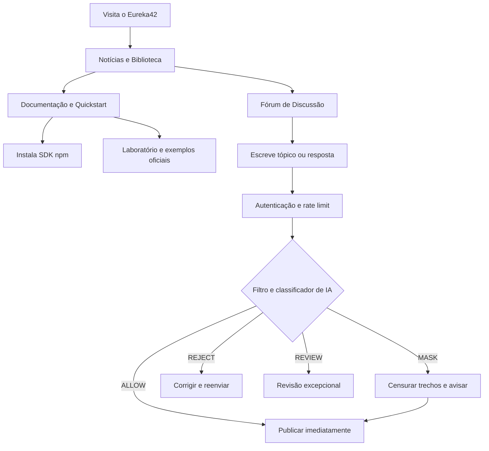
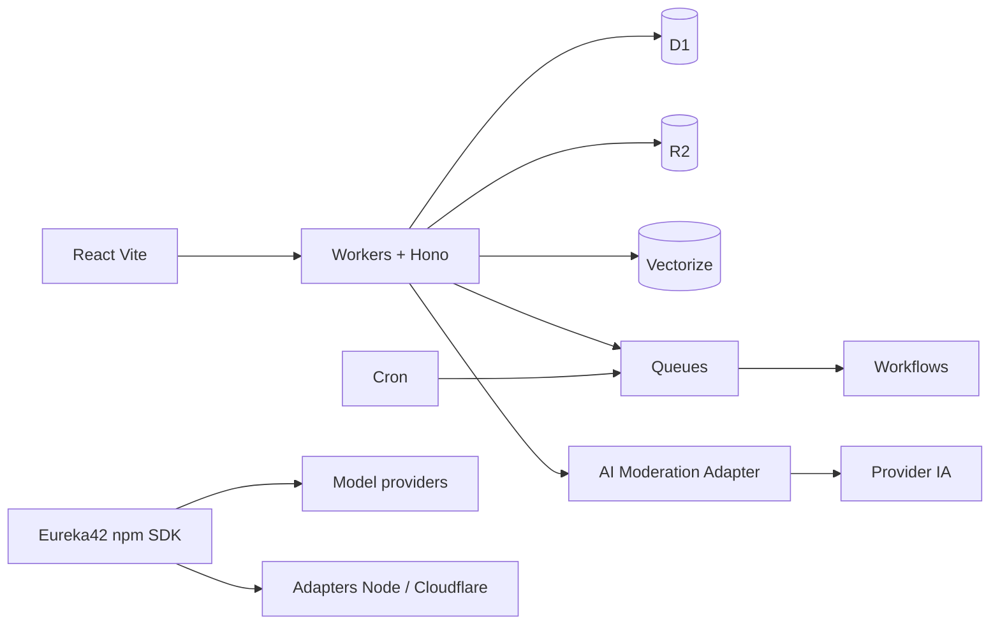

# EUREKA42 — MASTER SPECIFICATION

**Produto:** Eureka42 — AI Engineering Framework & Knowledge Ecosystem  
**Tipo:** ecossistema editorial multilíngue, biblioteca oficial, framework SDK TypeScript, documentação, laboratório técnico e fóruns de discussão.  
**Estado:** especificação inicial de produto e arquitetura, não implementação concluída.  
**Data-base:** 2026-11-03.  
**Metodologia:** ASES-300 + 200 requisitos de domínio para uma matriz de 500; a referência chamada ASES-500 em conversas anteriores não foi encontrada como MD exato e não deve ser considerada importada integralmente.  
**Identificação:** `E42-2026-001`; revisão 1.0.0; decisões abaixo classificadas como Confirmada (C), Proposta (P) ou Dependente de validação (V).

---

## 1. Visão e posicionamento

Eureka42 é uma plataforma de engenharia de inteligência artificial orientada a desenvolvedores, pesquisadores, equipes e estudantes. Une informação editorial confiável, uma biblioteca **oficial e curada** de módulos reutilizáveis, código aberto (quando licenciado), documentação técnica e uma comunidade com publicação restrita aos fóruns. A plataforma não é uma rede social, não é marketplace aberto a postagens de terceiros e não distribui modelos próprios na versão inicial.

**Promessa:** aprender um conceito; descobrir um padrão; instalar o pacote; construir e avaliar uma aplicação; discutir questões técnicas no fórum.

**Princípios técnicos:** API-first; contratos tipados; TypeScript strict; core portável; adapters opcionais; separação editorial/SDK; compatibilidade semântica; testes reprodutíveis; segurança por padrão; observabilidade; documentação multilíngue; baixos custos de entrada.

**Antipadrões proibidos:** framework que é apenas uma coleção de links; SDK acoplado ao backend do portal; guardar senhas/chaves em texto puro; publicar automaticamente artigos de terceiros sem licença; afirmar que benchmark não executado foi validado; exibir recursos sem implementação; gerar conteúdo sem atribuição; permitir upload/publicação fora dos fóruns por usuários comuns.

**Objetivos de negócio (P):** tornar-se referência em IA aplicada e engenharia em português e inglês, com expansão internacional; aumentar uso e contribuições ao código por canais de desenvolvimento controlados; criar documentação e frameworks específicos; sustentar o projeto por patrocínios, serviços, formação e/ou suporte futuro. Monetização não faz parte do MVP.

## 2. Decisões de produto

| ID | Decisão | Estado |
|---|---|---|
| DEC-001 | Nome da plataforma e SDK: Eureka42 | C |
| DEC-002 | Portal de notícias na home | C |
| DEC-003 | Biblioteca de frameworks oficiais, com módulos especializados | C |
| DEC-004 | Somente fórum permite publicação do público cadastrado | C |
| DEC-005 | IA no envio do fórum identifica palavrões e debates político-partidários | C |
| DEC-006 | A chave do provedor da IA será configurável no painel admin | C |
| DEC-007 | Produto multilíngue | C |
| DEC-008 | React, TypeScript, Vite, Tailwind; Cloudflare Workers + Hono, D1, R2, Vectorize, Queues, Workflows, Cron; MDX/GitHub; npm | C |
| DEC-009 | O SDK roda também fora da Cloudflare, com adapters específicos | P |
| DEC-010 | Publicações normais do fórum são visíveis imediatamente quando passam na checagem; sem aprovação humana obrigatória | C |
| DEC-011 | Core do fórum implementado na plataforma para garantir políticas próprias; GitHub Discussions só para discussão do código | P |
| DEC-012 | Idiomas iniciais: pt-BR, en-US, es-ES; arquitetura pronta para it-IT, fr-FR, de-DE | P |
| DEC-013 | Modelo de licença para SDK: MIT ou Apache-2.0 após revisão jurídica | V |
| DEC-014 | Domínios, marcas legais, titularidade, design final e políticas de privacidade | V |
| DEC-015 | Fórum não é local de debate político-partidário; a restrição se aplica igualmente a todas as perspectivas | C |

## 3. Público, usuários, perfis e superfície de publicação

**Visitante anônimo:** lê notícias, artigos, docs, componentes oficiais e discussões públicas; pesquisa sem publicar.  
**Membro:** edita sua conta e preferências, inicia tópico/responde *somente dentro do fórum*, denuncia conteúdo de terceiros, acompanha tópicos. Não publica notícia, curso, produto, modelo, artigo, SDK, pacote ou documentação.  
**Moderador:** cuida de denúncias e recursos, supervisiona falhas de IA, executa ações com log; não altera segredo do provedor.  
**Editor:** cria e revisa notícias, guias, biblioteca, páginas e traduções oficiais; não gerencia chaves e usuários.  
**Administrador:** configura recursos, papéis, provedor de IA e integrações, acesso a logs e controles editoriais.  
**Superadministrador:** contas privilegiadas, políticas e configurações sensíveis; MFA obrigatória; ações auditadas; conta de bootstrap protegida.  
**Service accounts:** ingestão, indexação, cron, publicação e testes; sem permissão de login como humano.

**Matriz mínima de escrita:**

| Recurso | Visitante | Membro | Moderador | Editor | Admin |
|---|---:|---:|---:|---:|---:|
| Notícias, docs e biblioteca | Ler | Ler | Ler | Criar/editar | Gerenciar |
| Tópicos e respostas do fórum | Ler público | Criar/editar próprios | Moderar | Criar como membro | Moderar |
| Páginas oficiais, trilhas e conteúdo de AI Labs | Ler/executar conforme acesso | Ler/executar | Ler/executar | Editar | Gerenciar |
| Denúncias/recursos | Não | Criar seus recursos e denúncias | Analisar | Sujeito a permissão | Gerenciar |
| API keys de moderação | Não | Não | Não | Não | Configurar/rotacionar |
| Código SDK público | Consultar/download | Consultar/download | Consultar/download | Conforme maintainer GitHub | Conforme maintainer GitHub |

**Regra negativa:** não criar perfil de autor externo, blog individual, feeds de usuários, mural social, uploads públicos de datasets/modelos ou publicação comunitária de pacotes. Envio de imagens ou anexos ao fórum fica **desativado no MVP**; possível extensão com checagem de arquivos e conteúdo, apenas para fóruns.

## 4. Mapa completo do portal

```
/
├── /{locale}/                     # home e notícias
├── /{locale}/news                 # listagem/filtros/editorias
│   └── /{slug}                    # notícia + fontes + links relacionados
├── /{locale}/insights             # artigos e análises oficiais
├── /{locale}/framework            # visão do Eureka42 Framework
│   ├── /getting-started
│   ├── /core
│   ├── /modules/{slug}
│   ├── /examples
│   ├── /integrations
│   ├── /changelog
│   └── /releases
├── /{locale}/library              # catálogo oficial de frameworks e bibliotecas
│   └── /{slug}
├── /{locale}/docs                 # documentação MDX versionada
│   └── /{version}/{path}
├── /{locale}/academy              # guias, tutoriais e trilhas editoriais
├── /{locale}/labs                 # demos oficiais, playground restrito
├── /{locale}/research             # referências e experimentos reproduzíveis
├── /{locale}/community            # índices públicos e regras
│   ├── /forum/{category}
│   ├── /topic/{slug}
│   └── /guidelines
├── /{locale}/about
├── /{locale}/privacy
├── /{locale}/terms
├── /{locale}/account              # perfil e preferências
└── /admin                         # interface administrativa restrita
    ├── /dashboard
    ├── /news /insights /library /docs /academy /labs
    ├── /translations /media /taxonomies /seo
    ├── /community /reports /appeals /moderation
    ├── /users /roles /audit /analytics
    ├── /ai-settings /provider-keys /moderation-policy
    └── /integrations /jobs /health /backups
```

Rotas técnicas `/api/v1/*`, `/health` autenticado onde apropriado, `/robots.txt`, `/sitemap.xml` e `/.well-known/security.txt`. URLs canônicas por idioma, sem tradução automática de slug já publicado sem mapeamento de redirecionamento.

## 5. Páginas e funcionalidades essenciais

### 5.1 Home
Hero enxuto, notícia principal e destaques editoriais; filtros por editoria e tags; bloco "Framework em destaque" com quickstart; biblioteca dos módulos mais importantes; novas versões oficiais; vitrine de documentação; tópicos recentes da comunidade; newsletter opcional com consentimento. Não há cards de postagens pessoais ou conteúdos de usuário fora do bloco de fórum.

### 5.2 Notícias
Fontes primárias e atribuição obrigatórias, período/data da ocorrência e da publicação, revisão editorial, tags, relações com módulos do framework, histórico de correção, marcação de conteúdo patrocinado quando houver. RSS/API são entrada para sugestões e rascunhos, não publicação automática indiscriminada. Editorial multilíngue revisa e aprova versões; mensagens de incerteza quando tradução ou dado não verificados. Evitar copiar material protegido de terceiros.

### 5.3 Biblioteca oficial
Cada item é uma ficha editorial com slug, categoria, versão, estado (`experimental`, `beta`, `stable`, `deprecated`), função, pré-requisitos, comando npm, exemplos, compatibilidade, limites, segurança, benchmarks com origem, changelog, docs, licença e repositório. Catálogo é curado exclusivamente pelo staff. "Biblioteca" significa catálogo de módulos oficiais e integrações verificadas; não upload comunitário.

### 5.4 Documentação e academia
MDX versionado, navegação de API, busca, copy-code, exemplos testáveis, trilhas do iniciante ao avançado, FAQ técnico, migração entre versões, manuais de contribuição ao código com PR revisada fora do portal. Conteúdo oficial somente staff. Traduções têm estado draft/review/published; fallback exibido como "disponível em outro idioma", nunca como tradução aprovada.

### 5.5 Fórum
Categorias: Geral técnico, Getting Started, Core/SDK, Agents, LLM, RAG, Workflows, Computer Vision, NLP/voz, Security/Evals, MLOps, Integrações, Problemas e sugestões, Projetos e demonstrações (apenas como tópicos textuais no fórum). Suporte a tópicos, respostas, markdown limitado, trechos de código, pesquisa, menções, notificações opt-in, tags, edição com histórico, denúncias, bloqueio e recursos de moderação. Rate limits, antispam e reputação básica. Busca por idioma e categorias; cada tópico preserva o idioma original; tradução sob demanda é opcional e rotulada.

### 5.6 Labs
Demonstrações mantidas por editores/desenvolvedores oficiais, playground com cotas, exemplos pré-carregados, comparador de saídas e métricas quando autorizadas. Usuários **não criam experimentos públicos** nem publicam configurações de Labs; podem levar suas dúvidas/resultados ao fórum. Limites de custo por sessão, IP/conta e provedor; nenhum segredo do servidor chega ao navegador.

## 6. Política exata de moderação IA no fórum

**Objetivo:** verificar somente conteúdo submetido ao fórum para (1) palavrões e ofensas, (2) debates político-partidários, independentemente de orientação; filtros técnicos de segurança (links maliciosos/spam/abuso automatizado) operam separadamente. Não transformar a IA em filtro geral de opiniões técnicas ou qualidade de perguntas.

**Processamento síncrono antes de persistir como publicado:**
1. autenticar e verificar limite; validar formato, extensão e campos;
2. filtro determinístico multilíngue de termos explícitos, com variantes e exceções por contexto;
3. solicitar classificação contextual ao modelo configurado pelo administrador, apenas quando necessário, com saída JSON validada por schema;
4. decisão `ALLOW` (publicação imediata), `MASK` (substituição dos termos e aviso), `REJECT` (usuário pode editar e reenviar), `REVIEW` (casos ambíguos, contestação ou modelo indisponível conforme política);
5. gravar a decisão e código de regra sem expor prompt confidencial nem guardar dados além da política de retenção;
6. usuário recebe motivo objetivo no idioma selecionado, com opção de recurso.

**Exemplos conceituais:** `"Como o NLP identifica palavrões?"` pode ser permitido como debate técnico; palavrão direcionado contra outro membro é mascarado/bloqueado; `"Qual partido votar?"` é debate político-partidário e rejeitado; `"Como modelos detectam viés político?"` é investigação técnica e pode ser permitido. Não classificar conteúdo como político somente por citar nomes de instituições ou expressões dentro de discussão técnica. Sem discriminação por ideologia.

**Falhas:** sem credenciais ou timeout da IA, aceitar apenas se os filtros determinísticos decidirem com segurança e a política o permitir; casos ambíguos ficam como `REVIEW`, não são publicados e não devem parecer publicados. O usuário pode consultar status. Não existe aprovação manual universal prévia; revisão humana é exceção/contestações. Se moderador reverter uma decisão, registrar ator, motivo e horário.

**Configuração admin:** toggle geral; provedor, modelo, endpoint validado/allowlist, secret key; versão de política; palavras proibidas por locale, limiar de confiança, modo máscara/rejeição, cotas e custo, fila de revisão, testes com exemplos, histórico e auditoria. Trocar chave sem redeploy exige cifrar o segredo no backend (AES-GCM com KEK em secret binding do Worker) ou integrar com Secrets Store; D1 só armazena ciphertext e metadados, nunca chave pura. Um segredo Cloudflare diretamente configurado no dashboard é alternativa segura, mas não satisfaz por si só a edição dentro do próprio painel. A UI exibe só últimos caracteres e não permite recuperar o valor.

**Contrato de saída de moderação (proposto):**
```json
{
  "decision": "ALLOW",
  "categories": [],
  "reasons": [],
  "confidence": 0.96,
  "masked_spans": [],
  "policy_version": "1.0.0",
  "locale": "pt-BR"
}
```
As categorias permitidas são `PROFANITY`, `PERSONAL_INSULT`, `PARTISAN_POLITICS`, `UNSAFE_LINK`, `SPAM`; modelo **não é fonte exclusiva** de regras de segurança. Validar offsets para evitar mascarar span errado em Unicode; preferir ranges ancorados ao texto/normalização e revalidar antes de publicar.

## 7. Internacionalização e localização

- Framework de mensagens tipadas com namespaces, ICU MessageFormat quando necessário e fallback explícito; evitar texto de UI fixado no código.
- Locales propostos: `pt-BR`, `en-US`, `es-ES` (MVP); `it-IT`, `fr-FR`, `de-DE` em fases posteriores; novos idiomas como configuração.
- Locales em URLs de conteúdo, selector acessível com preferência por conta/cookie; `Accept-Language` somente como sugestão inicial; idioma escolhido tem precedência.
- Suporte a datas, fusos, números, unidades, plural e interfaces RTL em roadmap; conteúdos de código, nomes de pacotes e identificadores técnicos não são traduzidos.
- Conteúdo editorial tem texto por idioma com revisor, status, versionamento e `hreflang`; fallback nunca indexado como se fosse tradução nativa.
- Fórum permite mensagens em múltiplos idiomas, moderadas no idioma original; autotradução de posts somente sob demanda e claramente identificada como tradução de máquina, sem mudar original.
- Busca híbrida por locale e conteúdos globais, com detecção configurável e estratégia de embeddings multilíngues.

## 8. Arquitetura obrigatória e fronteiras

### 8.1 Stack confirmada
| Camada | Escolha | Limite |
|---|---|---|
| Frontend | React, TypeScript strict, Vite, Tailwind CSS | UI somente; sem segredos |
| Hospedagem do frontend | Cloudflare Pages | build estático versionado; API separada em Workers |
| API | Cloudflare Workers, Hono, Zod e OpenAPI | autenticação/autorização no servidor |
| Dados relacionais | Cloudflare D1, migrations versionadas | dados editoriais, fórum e metadados |
| Armazenamento | Cloudflare R2 | assets oficiais, evidências e backups |
| Vetores | Cloudflare Vectorize | indexação de conteúdo/documentos públicos e técnico |
| Assíncrono | Cloudflare Queues e Workflows | publicação, tradução, indexação, recuperação |
| Agenda | Workers Cron Triggers | sincronização de fontes e manutenção |
| Cache | Cache API/KV quando justificado | invalidar ao publicar/editar |
| Docs | MDX no repositório GitHub | PR/revisão e versões |
| Distribuição | npm sob escopo `@eureka42/*` (a confirmar) | core sem dependência obrigatória de Cloudflare |
| Fórum | backend próprio Hono/D1 no MVP | controle síncrono da moderação de mensagens |

### 8.2 Princípio de isolamento
**Portal/CMS** e **SDK Eureka42** possuem ciclos de release separados; o portal consome metadados dos pacotes publicados, mas não é dependência runtime do SDK. **SDK Core** deve executar em Node moderno e runtimes web compatíveis. Cloudflare é adapter privilegiado, não fundação irremovível do core. LLMs podem ser oferecidos por terceiros e devem implementar contratos de provider com políticas de timeout, streaming, retry e custo. Nunca presumir que todo provider ofereça a mesma API.

### 8.3 Contextos de domínio (bounded contexts)
`identity`, `editorial`, `catalog`, `docs`, `forum`, `moderation`, `translation`, `search`, `labs`, `metrics`, `admin`, `integration`, `sdk-registry`. Integração via serviços de aplicação e eventos, não consultas arbitrárias entre contextos. Eventos com versionamento e idempotency key.

### 8.4 Fluxos principais




## 9. Framework Eureka42: arquitetura interna

### 9.1 Monorepo e pacotes oficiais (proposta)
```
eureka42/
  apps/
    web/                      # React + Vite + Tailwind
    api/                      # Hono Workers
    admin/                    # área administrativa integrada (mesma stack)
    docs/                     # MDX, gerado/servido no portal
  packages/
    core/                     # contracts/runtime/context/error/event
    models/                   # model/provider interface, generation, streaming
    prompts/                  # templates e versionamento
    agents/                   # executores, memória, tool calls, limites
    tools/                    # schemas, sandbox e permissões
    workflows/                # grafo, estado, retries e checkpoints
    rag/                      # ingestão, chunking, retrieval e citations
    memory/                   # context/memory interfaces, TTL
    evaluation/               # datasets, checks, comparadores e scorecards
    observability/            # tracing, telemetry, costs
    safety/                   # policy hooks, output constraints
    vision/                   # contratos para imagem/visão
    language/                 # texto, NLP e voz
    multimodal/               # entradas/saídas multimodais
    data/                     # validação, datasets, transformations
    integrations/             # conectores mantidos oficialmente
    cloudflare/               # adapters D1, R2, Vectorize, Queues
    node/                     # adapters Node (quando relevantes)
    react/                    # hooks opcionais e componentes integrados
    cli/                      # create, doctor, init, validate, migrate
    templates/                # blueprints de projeto
  infra/
    cloudflare/
    migrations/
  docs/
    requirements/
    adr/
    security/
    evaluation/
    runbooks/
  tests/
    unit/ integration/ e2e/ contract/ fixtures/
  examples/
    basic-chat/ agent-tools/ rag-citations/ safe-forum/ eval-pipeline/
  .github/workflows/
  package.json pnpm-workspace.yaml turbo.json tsconfig.base.json
```

### 9.2 Catálogo de frameworks especializados

| Família | Pacote proposto | Capacidades necessárias | Fase |
|---|---|---|---|
| Fundamentos | `@eureka42/core` | contracts, execution context, errors, lifecycle, hooks | MVP |
| Modelos/LLM | `@eureka42/models` | providers, chat, structured output, streaming | MVP |
| Engenharia de prompts | `@eureka42/prompts` | templates, variables, versioning | MVP |
| Agentes inteligentes | `@eureka42/agents` | roles, tools, budgets, guardrails | MVP |
| Ferramentas | `@eureka42/tools` | typed tools, permissions, schema | MVP |
| Workflows | `@eureka42/workflows` | DAG, state, retries, human checkpoint | Beta |
| RAG/Conhecimento | `@eureka42/rag` | loader, chunker, retrieval, citations | MVP |
| Memória | `@eureka42/memory` | storage interfaces, scope, retention | Beta |
| Avaliação | `@eureka42/evaluation` | datasets, assertions, metrics | MVP |
| Observabilidade | `@eureka42/observability` | traces, tokens, costs, timing | MVP |
| Segurança | `@eureka42/safety` | policies, PII redaction, guardrails | MVP |
| Data Engineering | `@eureka42/data` | datasets, pipeline, quality | Beta |
| Visão Computacional | `@eureka42/vision` | image inputs, classifications, OCR adapters | Futuro |
| NLP e Voz | `@eureka42/language` | speech-to-text, text-to-speech, translation | Futuro |
| Multimodal | `@eureka42/multimodal` | synchronized text/image/audio contracts | Futuro |
| Cloudflare | `@eureka42/cloudflare` | bindings, persistence, vector search, queues | MVP |
| Node | `@eureka42/node` | cross-runtime persistence and tooling | Beta |
| React | `@eureka42/react` | typed UX hooks, streaming state | Beta |
| Dev CLI | `@eureka42/cli` | new project, validate, doctor | MVP |

**Outras especializações futuras:** aprendizado de máquina clássico, deep learning, aprendizado por reforço, robótica, AutoML, otimização e séries temporais. Esses tópicos não serão falsamente oferecidos como frameworks operacionais antes de existir implementação pública e testada. O framework **não precisa reimplementar TensorFlow ou PyTorch**: deve criar contratos/adapters e fluxos de desenvolvimento onde a arquitetura TypeScript fizer sentido.

### 9.3 Contratos mínimos do SDK (pseudocódigo de design, NÃO API existente)
```ts
export interface Eureka42ModelProvider {
  id: string;
  generate(input: ModelRequest, context: ExecutionContext): Promise<ModelResponse>;
  stream?(input: ModelRequest, context: ExecutionContext): AsyncIterable<ModelChunk>;
}
export interface Eureka42Tool<I, O> {
  name: string;
  inputSchema: StandardSchema<I>;
  execute(input: I, context: ExecutionContext): Promise<O>;
}
export interface Eureka42Agent {
  id: string;
  run(input: AgentInput, options: RunOptions): Promise<AgentRunResult>;
}
```

**Padrões técnicos obrigatórios no core:** instâncias tipadas; interfaces pequenas; injeção de dependência, `AbortSignal`, suporte streaming como capacidade opcional, `Result`/erros normalizados, correlação por trace ID, deadlines, max iterations, custo máximo, provider capabilities, callbacks instrumentáveis, sistemas de plugin por contrato e sem `eval` arbitrário. Sem execução remota de código não confiável no Worker.

### 9.4 Níveis de maturidade
`EXPERIMENTAL` não garante API; `BETA` pode ajustar contratos com changelog; `STABLE` segue SemVer, mudanças incompatíveis geram major; `DEPRECATED` documenta substituição e janela de suporte; `REMOVED` possui nota de migração. Cada pacote tem matriz Node/Workers/web, limites de suporte e testes de contrato por provedor.

## 10. Administração: arquitetura funcional

**Dashboard:** conteúdo publicado, última ingestão RSS, publicações pendentes, forums, moderação por decisão/idioma, erros de provider, custo estimado da IA, storage/banco, versão deploy e alertas.

**CMS editorial:** notícias, análises, categorias, tags, fontes, autores internos, agenda de publicação, conteúdo multilingue, revisão, preview, rascunho, scheduler, redirecionamentos e SEO.

**Biblioteca e SDK:** metadados de packages, status de release, catálogos e integração com npm/GitHub, sincronização oficial verificada, docs, deprecações e distribuição.

**Fórum e moderação:** denúncias, revisão excepcional, auditoria de decisões, palavras/políticas por idioma, recurso, silenciamento, quotas, categorias, notificações.

**Configuração IA:** provedor, endpoint autorizado, seleção de modelo e fallback, teste de conexão, orçamento diário/mensal, políticas, prompt da moderação versionado, chave com cifragem/rotação, simulação com fixtures e logs expurgados.

**Infra e auditoria:** estado de jobs, reprocessamento idempotente, backups, métricas, separação de ambientes, acesso por RBAC, auditoria de mudanças sensíveis e alertas.

## 11. Dados principais e relacionamentos

Entidades essenciais: `User`, `Session`, `Role`, `Permission`, `Locale`, `EditorialArticle`, `EditorialTranslation`, `Source`, `Tag`, `MediaAsset`, `LibraryItem`, `LibraryRelease`, `DocumentationPage`, `ForumCategory`, `ForumTopic`, `ForumPost`, `ForumRevision`, `ForumReport`, `ForumAppeal`, `ModerationDecision`, `ModerationPolicy`, `ProviderCredential`, `AdminAuditEvent`, `IngestFeed`, `IngestRun`, `Job`, `ContentIndex`, `LabDemo`, `SdkPackage`, `SdkRelease`, `FeatureFlag`, `Redirect`. Estruturar IDs e FKs sem compartilhar secrets com tabelas de leitura pública.

**Restrições de integridade:** usuário autor do post por FK; `post` sempre pertence a `topic`; slug único no escopo de locale e entity; `moderation_decision` vincula versão específica do texto submetido; publicações têm `created_at`, `updated_at`, `published_at`, `status`; `editorial_translation` é única por conteúdo+locale; eventos auditados append-only; publicação/edição devem produzir invalidation/reindex atômico ou via outbox confiável.

**Retenção:** definir prazo por classe de dado com revisão jurídica; minimizar prompt enviado ao provedor; dados pessoais e conteúdo excluído não devem permanecer indefinidamente em Vectorize/índices e caches. Delete exige tombstone e job idempotente para apagar artefatos derivados. Backups criptografados e restauração testada.

## 12. APIs — grupos de contratos v1

| Método | Rota | Papel | Semântica |
|---|---|---|---|
| GET | `/api/v1/news` | público | filtros, paginação e locale |
| GET | `/api/v1/news/:slug` | público | conteúdo publicado, fontes |
| GET | `/api/v1/library` | público | catálogo oficial versionado |
| GET | `/api/v1/library/:slug` | público | ficha técnica |
| GET | `/api/v1/docs/search` | público | busca local/híbrida |
| GET | `/api/v1/forum/categories` | público | categorias |
| GET | `/api/v1/forum/topics` | público | tópicos visíveis |
| GET | `/api/v1/forum/topics/:id` | público | tópico e posts publicados |
| POST | `/api/v1/forum/topics` | membro | criar submetendo ao filtro |
| POST | `/api/v1/forum/topics/:id/posts` | membro | responder submetendo ao filtro |
| PATCH | `/api/v1/forum/posts/:id` | autor/moderador | editar e remoderar conteúdo novo |
| POST | `/api/v1/forum/posts/:id/reports` | membro | denunciar |
| POST | `/api/v1/forum/moderation/:id/appeals` | autor | recorrer |
| GET | `/api/v1/me` | membro | conta e preferências |
| GET/POST | `/api/v1/admin/news` | editor | gestão editorial |
| POST | `/api/v1/admin/moderation/test` | admin | executar teste com fixture |
| PUT | `/api/v1/admin/provider-credentials/:id` | admin | salvar chave sem echo |
| POST | `/api/v1/admin/provider-credentials/:id/test` | admin | testar conexão e permissão |
| GET | `/api/v1/admin/audit` | superadmin/admin autorizado | auditoria paginada |
| GET | `/api/v1/admin/jobs` | admin | saúde de tarefas |

**Padrão:** OpenAPI 3.1 + Zod; erros tipo RFC 9457 Problem Details quando apropriado; sessão protegida por cookie `HttpOnly`, `Secure`, `SameSite` e CSRF para estado; CSP, CORS allowlist, limite de payload, autenticação e autorização em cada rota. APIs públicas de leitura com rate limiting e cache. Rotas de admin exigem MFA.

## 13. Segurança, privacidade e moderação

Riscos principais: XSS em Markdown/MDX, SSRF via RSS e urls de provedores, prompt injection em conteúdo do fórum, uso indevido de ferramentas/LLM, vazamento de chave de IA, IDOR, CSRF, abuso de login, spam, manipulação de tradução, supply-chain do npm e custos inesperados de inference. Recomendações:
- Markdown de fórum com allowlist e sanitização HTML; MDX somente em pipeline oficial revisado, nunca gerado por usuário;
- URLs externas restritas em SSRF (DNS/IP privados e rebindings bloqueados); uploads do usuário desativados no MVP;
- não executar instruções embutidas no texto do usuário, da notícia, do RSS ou de docs como ordens de sistema;
- secrets em bindings/env de backend ou cifrados no servidor; proibir logs de token;
- autenticação com padrões testados e MFA admin; rate limits por IP/conta/rota;
- integrações com políticas de menor privilégio e budget de chamadas;
- corrigir falso positivo da moderação e permitir recurso;
- plano de resposta a incidentes, política de privacidade/LGPD e revisão jurídica antes da abertura pública.

## 14. Observabilidade, qualidade e SLOs preliminares

Metas **propostas**, a validar em baseline: disponibilidade alvo do portal >=99,5% em período mensal; p95 de GET cacheado <=300ms na borda sob cenário definido; p95 de API dinâmica <=800ms sem incluir inferência; processo síncrono de moderação com timeout 8s e saída controlada; cobertura de testes de contratos de componentes críticos 100%; nenhum release com falha de teste CRITICAL/HIGH; correção de vulnerabilidade crítica antes de release; ingestão de RSS com deduplicação; observabilidade de custo por módulo/provedor sem registrar dados privados. Tempo/latência reais devem ser medidos e especificados por ambiente e carga; métricas de IA não podem ser inventadas.

**Estratégia:** testes unitários Vitest; integração em runtime Workers; Playwright E2E; teste de contrato de schemas e adapters; fuzz/Unicode no filtro de conteúdo; auditoria de dependências; CI com lint/typecheck/test; cenários de recuperação de D1 e R2; checks de licenças; snapshots de tradução e acessibilidade.

## 15. Governança e rastreabilidade (ASES)

A referência disponível **ASES-300**, arquivo `ASES-300_COMPLETO_Capitulos_1_a_25_ABNT.docx`, apresenta núcleo de 300 requisitos gerais, complementados por requisitos específicos de domínio, com classificação `CORE`, `CONDITIONAL`, `DOMAIN`, prioridade, aceitação, evidências e rastreabilidade. Esta especificação conserva os 300 IDs e cria `REQ-301…REQ-500` específicos para Eureka42. *Isso não significa que o MD ASES-500 original, não localizado, foi importado.*

**Artefatos obrigatórios:** `README.md`, `AGENTS.md`, `PRODUCT.md`, `DOMAIN.md`, `HARNESS.md`, `RULES.md`, `MASTER-SPEC.md`, `requirements/ase-300.md`, `requirements/eureka42-301-500.md`, `requirements/traceability.yaml`, `ARCHITECTURE.md`, `ADR/`, `SECURITY.md`, `API.yaml`, `DATA_MODEL.md`, `EVALS.md`, `RUNBOOK.md`, `STATUS.md`, `DEFINITION_OF_DONE.md`, `skills/` e `progress/`.

**Estados:** `PENDING`, `IN_PROGRESS`, `BLOCKED`, `TESTED`, `PASS`, `FAIL`, `N/A` (com justificativa). Um requisito `PASS` precisa de evidência; não inferir aprovação por geração de código. Prioridade `CRITICAL` e `HIGH`: 100% aprovados antes de release na política inicial. Especificações de N/A não podem ser usadas para ignorar riscos de segurança.

**Loop Harness:** carregar STATUS e REQs -> escolher item elegível por dependência -> inspecionar implementação -> planejar alteração pequena -> implementar -> typecheck/lint/tests/evals -> arquivar evidência -> atualizar matriz de rastreabilidade -> avançar. Human gate para infraestrutura/custos, privilégios e mudanças sensíveis.

## 16. Backlog, fases e definição de entregas

### Fase 0: fundação e provas técnicas
Monorepo, tooling, CI, ambientes Cloudflare dev/staging/prod, modelagem D1, auth segura, design system, i18n, OpenAPI base, prova de cifragem de keys de IA e testes de moderação em vários idiomas. **Saída:** ambiente de staging demonstrável sem mocks de produção.

### Fase 1: MVP público editorial + fórum + core SDK
Portal multilíngue pt/en/es; home com notícias revisadas, CMS e RSS de ingestão como rascunho, catálogo oficial, docs MDX, fórum com moderação leve por IA configurável via admin, login/cadastro, busca básica, `@eureka42/core`, `models`, `agents` inicial, `rag` básico, `evaluation` inicial, docs e exemplos reais, npm beta. **Saída:** uso real do portal e instalação funcional do framework.

### Fase 2: crescimento técnico
Vectorize, ranking híbrido, SDK workflows/tooling, CLI doctor/init, observabilidade ampliada, AI Labs com quotas, métricas de custo, comunidade com melhores ferramentas, SEO avançado, novas integrações e traduções.

### Fase 3: internacionalização e profundidade
Mais idiomas, famílias vision/language/multimodal/data, benchmarks publicados e reproduzíveis, migrações de versão, pesquisa e academia avançada, revisão do negócio/financiamento.

**Critério de término por fase:** funcionalidades acessíveis; código/testes da versão; documentação por idioma comprometido; nenhuma credencial no navegador; testes negativos de autorização; edição de fórum passa novamente pela moderação; SDK compilável e importável por exemplo externo; indicadores e limites de custo visíveis; rollback e backup demonstrados.

## 17. Indicadores de sucesso

**Portal:** usuários únicos, leitura qualificada, páginas de documentos, taxas de busca sem resultado, fontes auditadas, tempo entre notícia e edição publicada.  
**Framework:** downloads verificados por npm, quickstart completado em teste, erros por pacote, compatibilidade por runtime, issues resolvidas, regressões, cobertura de contrato.  
**Fórum:** perguntas respondidas, tempo até resposta, proporção de posts bloqueados por política, taxa de reversão de falso positivo, custo por mil classificações, spam e denúncias.  
**Qualidade editorial:** percentuais de artigos com fontes oficiais, traduções revistas e correções documentadas.  
**Operação:** consumo Workers/D1/R2/Vectorize, tempos de inferência, falha de jobs, alertas, disponibilidade e custo.

## 18. Riscos e decisões ainda abertas

- Validação legal e disponibilidade de domínio; **não inferir disponibilidade por falta de website**.
- Política jurídica final sobre conteúdos políticos: banimento de debates partidários no fórum com exceção de discussão técnica sobre viés/políticas públicas de IA; publicar regra clara e uniforme.
- Licença dos pacotes: MIT vs Apache-2.0; nome do escopo npm, marca comercial e titularidade jurídica.
- Auth: escolher biblioteca compatível com Workers, D1, passkeys/OTP e recuperação, após PoC.
- Limites gratuitos de cloud/inferência devem ser validados no painel Cloudflare atual e revisados conforme escala.
- Abordagem de integração de fórum próprio vs Discourse após crescimento, com impacto em políticas de publicação e SSO.
- Escolher provider de moderação, limites de custo e retenção conforme contrato de dados e LGPD.
- Conteúdo editorial multilingue e equipe de revisão: dimensionamento operacional.
- Confirmar requisitos e registros do **MD ASES-500 original** caso seja disponibilizado ao projeto; ao importar, reconciliar IDs sem sobrescrever os 300 existentes.

## 19. Referências técnicas de implementação (consultadas em 2026-11-03)

- Hono para Cloudflare Workers: https://hono.dev/docs/getting-started/cloudflare-workers
- Cloudflare secrets: https://developers.cloudflare.com/workers/configuration/secrets/
- Cron Triggers: https://developers.cloudflare.com/workers/configuration/cron-triggers/
- Vectorize: https://developers.cloudflare.com/vectorize/
- Mastra (referência de design do framework TypeScript): https://mastra.ai/docs
- GitHub Discussions: https://github.com/features/discussions
- LangGraph: https://docs.langchain.com/oss/javascript/langgraph/overview
- OpenAI Agents SDK JS: https://openai.github.io/openai-agents-js/

## 20. Critério de orientação para o processo ASES-500 preexistente

Este documento é uma **entrada de especificação já respondida**. A entrevista original não deve reabrir decisões confirmadas (DEC-001…DEC-008, DEC-010, DEC-015). Dúvidas remanescentes devem virar ADR/DEC/V ou requisitos bloqueados, não perguntas redundantes. A execução deve:
1. ingerir MASTER SPEC e o catálogo das 500 REQs;
2. conservar a identidade dos 300 requisitos ASES-300 e vincular os 200 de domínio;
3. gerar produto/domínio/arquitetura, RACI, riscos, dados, OpenAPI, design tokens, Storybook e testes;
4. registrar toda decisão divergente em ADR;
5. implementar por dependências, com evidências e release gates;
6. gerar conteúdo editorial apenas como dados de seed demonstrativos identificados, nunca fingir que são notícias reais;
7. não simular plataforma pronta enquanto não houver integrações e testes executados.
