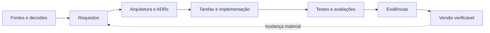
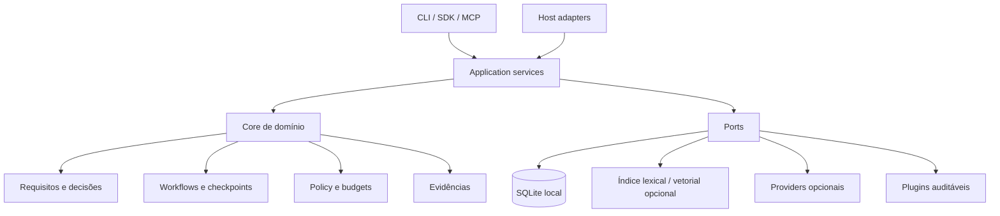

<p align="center">
  
</p>

<h1 align="center">EUREKA42 ASES Framework</h1>

<p align="center">
  <strong>From specification to verified software.</strong><br>
  Especificar com clareza. Construir com autonomia controlada. Comprovar com evidências.
</p>

<p align="center">
  <code>STATUS: desenvolvimento inicial</code> ·
  <code>VERSÃO: 0.0.0-dev</code> ·
  <code>PUBLICAÇÃO: não publicada</code> ·
  <code>LICENÇA: aguardando decisão</code>
</p>

> [!IMPORTANT]
> Este repositório é um projeto em desenvolvimento. O pacote ainda não foi publicado no npm, nenhum host foi declarado oficialmente suportado e o catálogo normativo ASES-300 não está presente neste repositório. Use a instalação local descrita abaixo.

## Visão geral

O EUREKA42 ASES Framework é uma plataforma local-first e vendor-neutral para engenharia de software orientada a agentes. A proposta é transformar especificações, decisões e requisitos em implementação rastreável, testes executados e evidências verificáveis — sem depender da memória privada de um único modelo ou de um único fornecedor.

O framework está sendo construído para operar em diferentes níveis:

- como CLI local e offline;
- como servidor MCP seguro via `stdio`;
- como camada de Skills e instruções para hosts como Codex, Claude Code, Kimi Code CLI e Gemini CLI;
- como runtime standalone com providers opcionais;
- como motor de requisitos ASES-300 e entrevista progressiva ASES-500;
- como base para workflows, RAG, memória documentada, checkpoints e evidências.



## Estado atual

O primeiro vertical slice de M0/M1 está implementado e verificado localmente:

| Capacidade | Estado | Observação |
|---|---|---|
| Monorepo TypeScript strict | Implementado | ESM, build por referências TypeScript |
| `ases --version` e ajuda | Implementado | Funciona offline |
| `ases init` | Implementado | Idempotente, JSON e `--dry-run` |
| `ases doctor` | Parcial | Node, plataforma, Git, npm, pnpm, workspace e config |
| `ases config validate` | Implementado no schema inicial | Configuração JSON bootstrap |
| `ases config explain` | Implementado no schema inicial | Informa valor e arquivo de origem |
| Backlog AFR-001..140 | Estruturado | Critérios ainda serão refinados por incremento |
| ASES-300 normativo | Bloqueado pela fonte | Nenhum REQ-001..300 foi inventado |
| ASES-500 separado | Validação necessária | Documento-mestre permanece proposta |
| MCP, hosts, providers e RAG | Planejado | Não declarar suporte antes dos testes |

O estado operacional detalhado está em [`STATUS.md`](STATUS.md) e as evidências executadas ficam em [`evidence/`](evidence/).

## Requisitos para desenvolvimento

### Ambiente verificado

- macOS arm64;
- Node.js `v26.8.1`;
- npm `11.9.0`;
- Git `2.50.1`.

### Política de versões

O manifesto aceita Node.js `>=22`, mas isso ainda é uma proposta técnica. Somente o ambiente acima foi testado nesta fase. A matriz de suporte para versões LTS e sistemas operacionais será promovida à medida que a CI multiplataforma produzir evidências reproduzíveis.

## Instalação local — caminho recomendado hoje

O projeto ainda não possui pacote público. Clone o repositório e execute a partir do código-fonte:

```bash
git clone https://github.com/eureka42-ai/ases-framework.git
cd ases-framework
npm ci
npm test
```

Para executar o CLI construído:

```bash
node packages/cli/dist/bin.js --version
node packages/cli/dist/bin.js help
```

Para disponibilizar o comando `ases` apenas no seu ambiente de desenvolvimento:

```bash
npm install --global ./packages/cli
ases --version
```

> [!CAUTION]
> A instalação global acima é destinada somente a desenvolvimento local. Não confunda esse fluxo com um pacote publicado ou uma versão estável.

### Desenvolvimento com pnpm

`pnpm` é o gerenciador-alvo do monorepo. Enquanto o lockfile definitivo do pnpm não for promovido neste repositório, `npm ci` é o caminho reproduzível verificado. Quando a migração do lockfile for concluída, o fluxo previsto será:

```bash
corepack enable
pnpm install --frozen-lockfile
pnpm build
pnpm test
```

Não use `--frozen-lockfile` antes de existir um `pnpm-lock.yaml` validado neste repositório.

## Primeiro uso

### 1. Ver a ajuda

```bash
ases help
```

### 2. Inspecionar o plano sem escrever

```bash
mkdir meu-projeto
ases init ./meu-projeto --dry-run --json
```

Saída esperada:

```json
{
  "status": "planned",
  "root": "/caminho/meu-projeto",
  "create": [
    "/caminho/meu-projeto/.ases/config.json",
    "/caminho/meu-projeto/.ases/STATUS.md",
    "/caminho/meu-projeto/NEXT_STEPS.md"
  ]
}
```

### 3. Inicializar o projeto

```bash
ases init ./meu-projeto
```

O comando cria apenas os arquivos que controla. Se o workspace já estiver inicializado, retorna `ASES_INIT_EXISTS` e não sobrescreve o conteúdo existente.

### 4. Diagnosticar o ambiente

```bash
ases doctor ./meu-projeto
ases doctor ./meu-projeto --json
```

### 5. Validar e explicar a configuração

```bash
ases config validate ./meu-projeto/.ases/config.json
ases config explain ./meu-projeto/.ases/config.json
ases config explain ./meu-projeto/.ases/config.json --json
```

## Comandos implementados

| Comando | Finalidade | Efeito colateral |
|---|---|---|
| `ases help` | Exibe ajuda e comandos disponíveis | Nenhum |
| `ases --version` | Exibe a versão do CLI | Nenhum |
| `ases init [diretório]` | Inicializa `.ases/` e próximos passos | Cria arquivos locais |
| `ases init --dry-run` | Mostra o plano de inicialização | Nenhum |
| `ases doctor [diretório]` | Diagnostica ferramentas e workspace | Nenhum |
| `ases config validate [path]` | Valida o contrato inicial da config | Nenhum |
| `ases config explain [path]` | Mostra valores e suas origens | Nenhum |

Os demais comandos do documento-mestre são contratos planejados, não funcionalidades existentes. Eles somente serão documentados como disponíveis depois de implementados e testados.

## Arquitetura pretendida



Princípios:

- Ports & Adapters nas fronteiras;
- core independente do host e do provider;
- funcionamento básico offline;
- validação em runtime, não apenas tipos TypeScript;
- política deny-by-default para ações sensíveis;
- automação idempotente, resumível e limitada por budgets;
- evidência objetiva para estados `VERIFIED`;
- integrações externas opt-in.

## Estrutura do repositório

```text
ases-framework/
├── AGENTS.md                  # regras compactas para agentes
├── README.md                  # este guia
├── STATUS.md                  # checkpoint operacional
├── docs/
│   ├── adr/                   # decisões arquiteturais
│   ├── assets/brand/          # identidade visual utilizada neste README
│   ├── compatibility/         # fontes oficiais e matriz futura
│   ├── PROJECT-CHARTER.md
│   ├── SOURCE-REGISTER.md
│   ├── DECISIONS.md
│   ├── RISK-REGISTER.md
│   └── ROADMAP.md
├── evidence/                  # provas de build, teste e smoke
├── packages/
│   └── cli/                   # primeiro vertical slice executável
├── requirements/
│   └── framework.yaml         # AFR-001..140
├── schemas/
│   └── ases.config.schema.json
└── scripts/                   # geração determinística e registros
```

## Metodologias e espaços de IDs

O projeto mantém espaços de identificação distintos:

| Prefixo | Significado |
|---|---|
| `REQ-*` | Requisitos normativos ASES-300 ou de um projeto usuário |
| `AFR-*` | Requisitos do produto EUREKA42 ASES Framework |
| `PROC-*` | Regras processuais do motor ASES-500 |
| `DEC-*` | Decisões do projeto |
| `ADR-*` | Registros arquiteturais |
| `AC-*` | Critérios de aceite |
| `EVD-*` | Evidências verificáveis |

O arquivo [`requirements/framework.yaml`](requirements/framework.yaml) contém os 140 AFRs extraídos do documento-mestre. A existência de um requisito no YAML não significa que ele esteja implementado ou verificado.

## Segurança e autonomia controlada

O runtime completo deverá aplicar as políticas antes de cada operação, inclusive quando acionado por MCP ou agentes delegados.

Capacidades previstas incluem:

- `read:project` e `write:project` com fronteira de workspace;
- `shell:safe` com argumentos estruturados;
- `network:allowlisted`;
- `secrets:access` por referência e nunca em logs;
- gates para publicação, exclusão, escrita externa e inferência paga;
- proteção contra path traversal, symlinks, SSRF e command injection;
- isolamento de conteúdo RAG e outputs de tools não confiáveis;
- budgets de passos, tempo, tokens, custo e retries.

Nenhum segredo deve ser commitado. Arquivos `.env`, caches, logs e backups locais devem permanecer fora do Git.

## Testes e evidências

Execute a validação atual com:

```bash
npm test
npm pack --workspace packages/cli --dry-run
git diff --check
```

A suite atual cobre:

- versão offline;
- `init --dry-run` sem escrita;
- inicialização idempotente;
- validação da configuração;
- explicação das origens da configuração;
- diagnóstico de ferramentas locais.

Resultados reais e limitações ficam em [`evidence/`](evidence/). Uma funcionalidade somente recebe `VERIFIED` quando a evidência estiver ligada ao comportamento, ambiente e versão corretos.

## Roadmap resumido

| Marco | Objetivo | Estado |
|---|---|---|
| M0 | Bootstrap, fontes, ADRs, riscos e build | Parcialmente verificado |
| M1 | CLI local, init, doctor, config e pacote | Em desenvolvimento |
| M2 | Catálogo ASES-300 e requirements engine | Bloqueado pela fonte normativa para catálogo real |
| M3 | Entrevista ASES-500 e geração de spec | Planejado |
| M4–M5 | MCP e adapters de hosts | Planejado |
| M6–M8 | Providers, agents, skills e workflows | Planejado |
| M9–M10 | RAG, memória e ContextBundle | Planejado |
| M11–M13 | Evals, segurança, observabilidade e hardening | Planejado |
| M14 | Release candidate e gate de v1 | Não autorizado |

Consulte [`docs/ROADMAP.md`](docs/ROADMAP.md) e [`STATUS.md`](STATUS.md) para o próximo incremento seguro.

## Compatibilidade com hosts

| Host | Estado atual |
|---|---|
| OpenAI Codex | `NOT_TESTED` |
| Claude Code | `NOT_TESTED` |
| Kimi Code CLI | `NOT_TESTED` |
| Gemini CLI | `NOT_TESTED` |
| MCP genérico | `NOT_IMPLEMENTED` |

Artefatos de integração não serão instalados em configurações globais sem plano, diff, backup e autorização. Uma integração somente será promovida a `SUPPORTED` após smoke test reproduzível em versão e sistema operacional documentados.

## Troubleshooting

### `pnpm` tenta acessar a rede ou não está instalado

Use o caminho atualmente verificado:

```bash
npm ci
npm test
```

Não altere configurações globais do Corepack apenas para contornar um ambiente restrito.

### `ases: command not found`

Execute o binário construído diretamente:

```bash
npm run build
node packages/cli/dist/bin.js help
```

Ou faça o link local de desenvolvimento:

```bash
npm install --global ./packages/cli
```

### A configuração não é encontrada

Inicialize o projeto ou passe o caminho explicitamente:

```bash
ases init .
ases config validate ./.ases/config.json
```

### Posso usar providers de IA agora?

Ainda não pelo runtime ASES. O modo inicial é determinístico e offline. Providers serão adicionados por adapters com autenticação, timeout, budgets, redaction e testes separados.

## Contribuição

O processo formal de contribuição ainda será consolidado. Por enquanto:

1. abra uma issue descrevendo problema, comportamento esperado e risco;
2. relacione a mudança a um `AFR-*` quando aplicável;
3. registre ADR para contratos ou decisões difíceis de reverter;
4. mantenha o incremento pequeno e testável;
5. execute build, testes e smoke do pacote;
6. não inclua secrets, dados privados ou alegações de suporte não testadas.

Commits usam mensagens no estilo Conventional Commits:

```text
feat: adiciona capacidade verificável
fix: corrige comportamento com regressão
docs: melhora documentação sem alterar contrato
test: adiciona evidência automatizada
chore: manutenção interna
```

## Identidade visual

<p align="center">
  
</p>

Os assets utilizados foram organizados a partir da pasta de identidade visual do projeto Eureka42. A marca segue a paleta Noite e Teal; não deve ser distorcida, redesenhada com glifo de sistema, receber glow, sombra ou cores não previstas.

Proveniência e hashes dos arquivos devem ser preservados antes de publicação pública. O uso no repositório não resolve, por si só, as decisões pendentes de licença e titularidade.

## Governança, licença e publicação

Permanecem pendentes de decisão humana:

- licença do software e da metodologia;
- titularidade e autorização de distribuição do ASES-300/500;
- nome definitivo do pacote npm;
- política de plugins comunitários;
- hosts e plataformas oficialmente suportados;
- orçamento de testes live e providers iniciais;
- eventual serviço remoto e sua operação.

Nenhum `npm publish`, release público, infraestrutura cloud ou configuração global será executado sem autorização explícita e gates de segurança.

---

<p align="center">
  
</p>

<p align="center">
  <strong>EUREKA42 ASES</strong><br>
  From specification to verified software.
</p>

