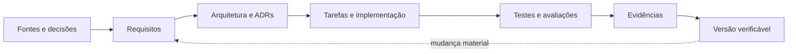
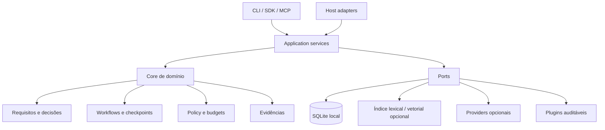
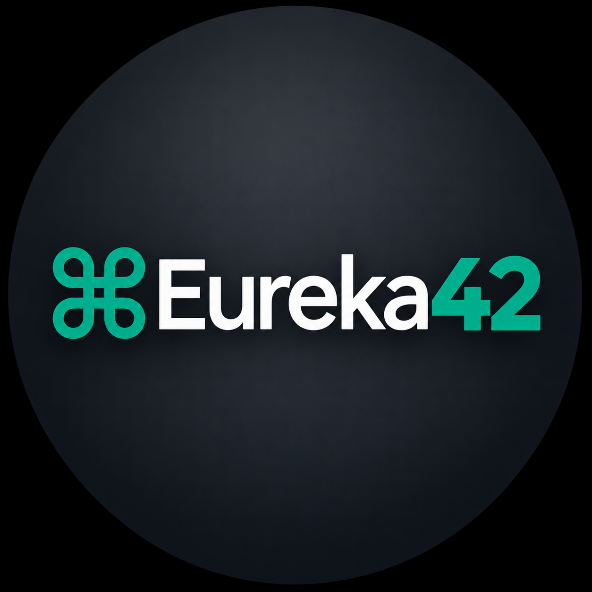

<p align="center">
  
</p>

<h1 align="center">EUREKA42 ASES Framework</h1>

<p align="center">
  <strong>From specification to verified software.</strong><br>
  Especificar com clareza. Construir com autonomia controlada. Comprovar com evidências.
</p>

<p align="center">
  <code>STATUS: desenvolvimento inicial</code> ·
  <code>VERSÃO: 0.1.0-rc.1 (candidata)</code> ·
  <code>PUBLICAÇÃO: não publicada</code> ·
  <code>CÓDIGO: Apache-2.0</code> ·
  <code>MÉTODO E MARCA: direitos reservados; validação de titularidade pendente</code>
</p>

> [!IMPORTANT]
> Este repositório é um projeto em desenvolvimento. O pacote ainda não foi publicado no npm, nenhum host foi declarado oficialmente suportado e o catálogo normativo ASES-300 não está presente neste repositório. Use a instalação local descrita abaixo.

Leia também o [guia em inglês](README.en.md).

## Visão geral

O EUREKA42 ASES Framework é uma plataforma local-first e vendor-neutral para engenharia de software orientada a agentes. A proposta é transformar especificações, decisões e requisitos em implementação rastreável, testes executados e evidências verificáveis — sem depender da memória privada de um único modelo ou de um único fornecedor.

O framework está sendo construído para operar em diferentes níveis:

- como CLI local e offline;
- como servidor MCP seguro via `stdio`;
- como camada de Skills e instruções para hosts como Codex, Claude Code, Kimi Code CLI e Gemini CLI;
- como runtime standalone com providers opcionais;
- como motor de requisitos ASES-300 e entrevista progressiva ASES-500;
- como base para workflows, RAG, memória documentada, checkpoints e evidências.



## Estado atual

O primeiro vertical slice de M0/M1 está implementado e verificado localmente:

| Capacidade | Estado | Observação |
|---|---|---|
| Monorepo TypeScript strict | Implementado | ESM, build por referências TypeScript |
| `ases --version` e ajuda | Implementado | Funciona offline |
| `ases init` | Implementado | Idempotente, JSON e `--dry-run` |
| `ases doctor` | Implementado localmente | Node, plataforma, Git, npm, pnpm, workspace/config e ações corretivas |
| `ases config validate` | Implementado no schema inicial | Configuração JSON bootstrap |
| `ases config explain` | Implementado no schema inicial | Informa valor e arquivo de origem |
| Backlog AFR-001..140 | Em andamento | 102 implementados; 38 pendentes. Ver [`docs/ROADMAP.md`](docs/ROADMAP.md) para distribuição por marco |
| Catálogo ASES-300 | Engine local implementada; homologação pendente | 300 itens importados com hash; conversão ainda requer revisão integral |
| ASES-500 separado | Validação necessária | Documento-mestre permanece proposta |
| MCP e integrações de hosts | Implementação local parcial | MCP read-only e quatro adapters experimentais; descoberta em sessão real ainda não comprovada para todos os hosts |
| Providers | SPI e mock local implementados | Sem provider remoto, credenciais ou inferência conectada |
| Agents, RAG offline e ContextBundle | Implementados localmente | Workflows com gate independente; RAG com citações/ACL/refresh; memória local consentida; bundle com redaction/hash e import ZIP seguro. [Guia RAG](docs/rag/offline-index.md) · [Guia de memória](docs/context/memory-and-bundles.md) · [Guia de import](docs/context/bundle-import.md) |

O estado operacional detalhado está em [`STATUS.md`](STATUS.md) e as evidências executadas ficam em [`evidence/`](evidence/).
O plano e os gates da candidata npm estão em [`docs/RELEASE.md`](docs/RELEASE.md).

## Requisitos para desenvolvimento

### Ambiente verificado

- macOS arm64;
- Node.js `v26.8.1`;
- npm `11.9.0`;
- Git `2.50.1`.

### Política de versões

O manifesto aceita Node.js `>=22`, mas isso ainda é uma proposta técnica. Somente o ambiente acima foi testado nesta fase. A matriz de suporte para versões LTS e sistemas operacionais será promovida à medida que a CI multiplataforma produzir evidências reproduzíveis.

## Instalação local — caminho recomendado hoje

O projeto ainda não possui pacote público. Clone o repositório e execute a partir do código-fonte:

```bash
git clone https://github.com/eureka42-ai/ases-framework.git
cd ases-framework
corepack pnpm install --frozen-lockfile
corepack pnpm test
```

Para executar o CLI construído:

```bash
node packages/cli/dist/bin.js --version
node packages/cli/dist/bin.js help
```

Para disponibilizar o comando `ases` apenas no seu ambiente de desenvolvimento:

```bash
npm install --global ./packages/cli
ases --version
```

> [!CAUTION]
> A instalação global acima é destinada somente a desenvolvimento local. Não confunda esse fluxo com um pacote publicado ou uma versão estável.

### Desenvolvimento com pnpm

`pnpm@10.20.0` é fixado em `package.json` e `pnpm-lock.yaml`; Corepack seleciona essa versão. O fluxo reproduzível verificado é:

```bash
corepack pnpm install --frozen-lockfile
corepack pnpm lint
corepack pnpm typecheck
corepack pnpm build
corepack pnpm test:unit
corepack pnpm integrations:validate
corepack pnpm smoke
corepack pnpm test
```

O workflow [`CI`](.github/workflows/ci.yml) roda os gates separadamente em Node.js 22 e 24. `lint` cobre whitespace rastreado e sintaxe dos scripts; typecheck e suíte verificam TypeScript e comportamento. Isso ainda não declara auditoria de dependências/licenças/SBOM.

## Primeiro uso

### 1. Ver a ajuda

```bash
ases help
```

### 2. Inspecionar o plano sem escrever

```bash
mkdir meu-projeto
ases init ./meu-projeto --dry-run --json
```

Saída esperada:

```json
{
  "status": "planned",
  "root": "/caminho/meu-projeto",
  "create": [
    "/caminho/meu-projeto/.ases/config.json",
    "/caminho/meu-projeto/.ases/STATUS.md",
    "/caminho/meu-projeto/NEXT_STEPS.md",
    "/caminho/meu-projeto/.ases/install-manifest.json"
  ]
}
```

### 3. Inicializar o projeto

```bash
ases init ./meu-projeto
```

O comando cria apenas os arquivos que controla. Se o workspace já estiver inicializado, retorna `ASES_INIT_EXISTS` e não sobrescreve o conteúdo existente.

### 4. Remover os arquivos iniciais sem apagar trabalho do projeto

`ases uninstall ./meu-projeto` mostra um plano. Só os arquivos listados no manifesto local e ainda idênticos aos hashes registrados podem ser removidos. Revise o plano e acrescente `--apply` para executá-lo:

```bash
ases uninstall ./meu-projeto --json
ases uninstall ./meu-projeto --apply
```

Arquivos modificados, symlinks, entrevistas, catálogos e outros dados dentro de `.ases/` são preservados. O diretório `.ases/` só sai se estiver vazio. Um workspace inicializado por uma versão anterior sem `.ases/install-manifest.json` não é removido automaticamente; os arquivos ficam intactos para revisão manual.

### 5. Diagnosticar o ambiente

```bash
ases doctor ./meu-projeto
ases doctor ./meu-projeto --json
```

### 6. Validar e explicar a configuração

```bash
ases config validate ./meu-projeto/.ases/config.json
ases config explain ./meu-projeto/.ases/config.json
ases config explain ./meu-projeto/.ases/config.json --json
ASES_PROJECT_MODE=offline ases config explain ./meu-projeto/.ases/config.json --set project.mode=headless
```

`config explain` resolve `defaults → arquivo → ambiente → flags`; por exemplo, `ASES_PROJECT_NAME`, `ASES_PROJECT_ID`, `ASES_PROJECT_LOCALE` e `ASES_PROJECT_MODE` podem sobrescrever o arquivo. `--set project.mode=offline` tem a maior precedência. A resolução aceita apenas chaves allowlistadas e não enumera nem imprime outras variáveis de ambiente ou valores secretos. `config validate` continua verificando o arquivo explícito sem aplicar overrides.

## Comandos implementados

| Comando | Finalidade | Efeito colateral |
|---|---|---|
| `ases help` | Exibe ajuda e comandos disponíveis | Nenhum |
| `ases --version` | Exibe a versão do CLI | Nenhum |
| `ases init [diretório]` | Inicializa `.ases/` e próximos passos | Cria arquivos locais |
| `ases init --dry-run` | Mostra o plano de inicialização | Nenhum |
| `ases uninstall [diretório]` | Planeja desinstalação dos arquivos ASES ainda intactos | Nenhum; exige `--apply` para remover, compara SHA-256 e preserva alterações/dados |
| `ases welcome [--color|--no-color]` | Exibe a marca Eureka42 em verde; respeita TTY e `NO_COLOR`, `--color` força a abertura dos plugins e `--no-color` desliga ANSI | Nenhum |
| `ases interview [diretório]` | Pergunta tipo, stack, hospedagem, banco, escala e dados | Cria proposta em `.ases/` |
| `ases interview --answers <json>` | Executa a entrevista de modo reproduzível | Cria proposta em `.ases/` |
| `ases doctor [diretório]` | Diagnostica ferramentas e workspace | Nenhum |
| `ases config validate [path]` | Valida o contrato inicial da config | Nenhum |
| `ases config explain [path] [--set chave=valor]` | Resolve defaults e overrides seguros com suas origens | Nenhum |
| `ases host list` | Detecta Codex, Claude, Kimi e Gemini instalados | Nenhum |
| `ases host plan <host> [workspace]` | Mostra diffs de integração, conflitos e arquivos binários sem aplicar mudanças | Nenhum |
| `ases host apply <host> [workspace]` | Mostra plano; `--apply` instala arquivos locais sem sobrescrever destinos | `.ases/host-install-<host>.json` |
| `ases host update <host> [workspace]` | Mostra plano; `--apply` atualiza arquivos ASES intactos e faz backup antes de substituir | `.ases/backups/hosts/<host>/` e manifesto de propriedade |
| `ases host uninstall <host> [workspace]` | Mostra plano; `--apply` remove somente arquivos intactos rastreados | Manifesto de propriedade da integração |
| `ases mcp [workspace]` | Serve ferramentas MCP de requisitos por stdio (read-only) | Nenhum |
| `ases catalog import-ases300 <md> [workspace]` | Valida 300 IDs e importa o catálogo geral | Grava `.ases/catalogs/ases-300.json` |
| `ases catalog import-product <id> <md> [workspace]` | Importa REQ-301..500 para catálogo específico | Grava `.ases/catalogs/products/<id>.json` |
| `ases requirements list [workspace] [--product id]` | Lista requisitos gerais ou específicos | Nenhum |
| `ases requirements show [workspace] <REQ-ID> [--product id]` | Exibe origem, texto e critério de aceite | Nenhum |
| `ases requirements trace [workspace] [REQ-ID] [--product id]` | Mostra decisão → requisito → testes → evidências e integridade | Nenhum |
| `ases requirements set-status <workspace> <REQ-ID> <status> [--product id]` | Atualiza estado e rastreabilidade; `VERIFIED` exige evidência hashada e contexto | Grava catálogo local |
| `ases requirements set-decision <workspace> <REQ-ID> <state> [--product id]` | Atualiza decisão sem alterar estado da implementação | Grava catálogo local |

Os demais comandos do documento-mestre são contratos planejados, não funcionalidades existentes. Eles somente serão documentados como disponíveis depois de implementados e testados.

Para marcar um requisito como `VERIFIED`, associe uma evidência local e registre como foi produzida com `--execution-context`; veja [vínculo de evidências e validade](docs/requirements/evidence-linking.md).

O engine de políticas é default-deny; ferramentas e planos de comando exigem autorização explícita. Saídas de ferramentas ficam separadas de regras, e logs estruturados têm redaction segura. Veja [política de segurança e comandos](docs/security/policy-engine.md) e [logging com redaction](docs/security/safe-logging.md).

Observabilidade local, consentimento revogável para telemetria remota e evals com fixtures versionadas estão documentados em [observabilidade e avaliações](docs/security/observability.md).

O SDK de plugins inclui template, validação de manifesto/integridade/fonte/compatibilidade, aprovação de permissões extras e contract tests. Consulte [SDK e contrato do registry](docs/plugins/sdk.md).

Remova plugins instalados com `ases plugin remove <plugin-id> [workspace]`; o padrão gera plano sem escrever. Revise o resultado e passe `--apply` para executar. Arquivos editados, symlinks e dados fora do manifesto de propriedade são preservados. Consulte [lifecycle e remoção segura](docs/plugins/lifecycle.md).

Atualizações de host mantêm snapshots hashados. Consulte o plano com `ases host restore <host> <backup-id> [workspace]`; passe `--apply` depois de revisar para restaurar. Manifestos ou snapshots adulterados são rejeitados: [guia de backups](docs/cli/backups.md).

### Códigos de saída

Veja a [tabela de códigos de erro e ações corretivas](docs/cli/errors.md) para códigos estruturados, causas e recuperação sugerida.

| Código | Significado |
|---:|---|
| `0` | Comando executado com sucesso |
| `1` | Comando desconhecido |
| `2` | Uso, opção ou pré-condição inválida |
| `3` | Configuração inválida ou indisponível |
| `4` | Respostas da entrevista inválidas |
| `5` | Catálogo ou requisito indisponível/inválido |

### Importar a fonte ASES-300

As fontes locais estão organizadas em `FONTES_ASES_PARA_DESKTOP_FRAMEWORK/`. Importe a conversão Markdown para um workspace:

```bash
ases catalog import-ases300 \
  ./FONTES_ASES_PARA_DESKTOP_FRAMEWORK/markdown/ASES-300_DOCUMENTACAO_INTEGRAL.md \
  ./meu-projeto
ases requirements list ./meu-projeto
ases requirements show ./meu-projeto REQ-001
```

O importador exige exatamente `REQ-001..REQ-300`, sem lacunas ou duplicatas, registra SHA-256 e conserva o texto e o critério de aceite de cada requisito. O artefato é local em `.ases/catalogs/ases-300.json` e inicia como `IMPORTED_NOT_HOMOLOGATED`, pois a conversão Markdown ainda requer revisão contra o DOCX. A referência específica Eureka42 não é misturada ao catálogo geral.

Requisitos específicos de produto usam outro arquivo e outro filtro de IDs. A matriz Eureka42 local contém a consolidação ASES e os 200 requisitos de domínio; somente `REQ-301..REQ-500` são importados para `.ases/catalogs/products/eureka42.json`:

```bash
ases catalog import-product eureka42 \
  ./FONTES_ASES_PARA_DESKTOP_FRAMEWORK/referencia_especifica_eureka42/05_EUREKA42_REQUISITOS_500_CONSOLIDADOS.md \
  ./meu-projeto
ases requirements list ./meu-projeto --product eureka42
ases requirements show ./meu-projeto REQ-301 --product eureka42
```

Estados podem ser atualizados com `PENDING`, `READY`, `IN_PROGRESS`, `IMPLEMENTED`, `VERIFIED`, `FAILED`, `BLOCKED` e `N_A`. `VERIFIED` exige `--evidence`; `N_A` exige `--na-reason`:

```bash
ases requirements set-status ./meu-projeto REQ-001 IMPLEMENTED
ases requirements set-status ./meu-projeto REQ-001 IMPLEMENTED --decision ADR-001 --test "packages/api/test/records.test.ts"
ases requirements set-status ./meu-projeto REQ-001 VERIFIED --evidence "evidence/resultado-teste.txt" --execution-context "pnpm test no Node 22" --decision ADR-001 --test "packages/api/test/records.test.ts"
ases requirements set-status ./meu-projeto REQ-002 N_A --na-reason "Capacidade fora do escopo aprovado nesta versão"
ases requirements set-status ./meu-projeto REQ-003 BLOCKED --blocked-by "credencial OIDC" --reason "A equipe ainda não recebeu o client secret de homologação."
ases requirements set-decision ./meu-projeto REQ-001 ACCEPTED --ref ADR-001 --reason "Alternativa aprovada pelo responsável técnico."
ases requirements trace ./meu-projeto REQ-001 --json
```

Para `VERIFIED`, `--evidence` deve apontar para um arquivo regular existente dentro do workspace. O CLI calcula SHA-256 e rejeita caminhos externos e links simbólicos que escapem do workspace. `requirements show` recalcula a integridade e marca a evidência como `CURRENT`, `STALE`, `MISSING`, `OUTSIDE_WORKSPACE` ou `UNVERIFIABLE`; isso identifica mudanças no arquivo, mas não avalia se o conteúdo comprova semanticamente o critério de aceite.

## Entrevista inteligente de projeto

O fluxo interativo começa pela natureza da aplicação e só recomenda tecnologia onde existe uma lacuna:

```bash
ases welcome
ases interview ./meu-projeto
```

Para continuar uma entrevista já salva, use `ases interview ./meu-projeto --resume`. As respostas atuais aparecem como padrão: pressione Enter para mantê-las ou informe um novo valor. As recomendações e o `SPEC.md` são recalculados. O fluxo normal continua recusando sobrescrever arquivos existentes; a atualização só ocorre quando `--resume` é explícito.

`ases interview` exibe a marca EUREKA42 em teal/verde antes da primeira pergunta. Em modo JSON, informe `--answers <arquivo.json>` para manter `stdout` válido e não misturar perguntas interativas com a saída estruturada.

Antes das perguntas interativas, consulta manifestos conhecidos no diretório informado (`package.json`, `tsconfig.json`, manifests de linguagens e arquivos de deploy/container). Mostra os arquivos encontrados e pistas de nome, tipo, linguagem e banco. Essas pistas são editáveis e não confirmam escolhas. Um `Dockerfile` indica container, mas não define o provedor de hospedagem. Arquivos `.env` e credenciais não são lidos.

Perguntas iniciais:

1. nome e tipo do aplicativo;
2. linguagem já escolhida ou sugestão necessária;
3. hospedagem já escolhida ou sugestão necessária;
4. banco de dados já escolhido ou sugestão necessária;
5. escala esperada;
6. presença de dados pessoais ou sensíveis.

Quando a pessoa já possui uma escolha, o ASES a registra como `REVIEW_REQUIRED` e compara com uma referência apropriada. Quando não possui, gera uma recomendação `PROPOSED` com justificativa. Nada vira `CONFIRMED` automaticamente.

A avaliação também cruza respostas com pistas dos manifestos locais. Divergências de tipo, linguagem ou banco são marcadas `CONTRADICTION` para revisão humana; o framework não assume que o manifesto está certo. Declarar dados sensíveis ou escala grande cria `BLOCKS_CONFIRMATION`: a SPEC continua como proposta, mas a confirmação da especificação/arquitetura depende de registrar a revisão de privacidade ou o baseline de carga e observabilidade. Os achados e suas fontes aparecem no resumo, em `.ases/interview.json` e em `.ases/SPEC.md`.

Para automação ou CI, use um arquivo de respostas:

```bash
ases interview ./meu-projeto \
  --answers ./examples/interview.answers.json \
  --dry-run \
  --json
```

Sem `--dry-run`, são gerados:

- `.ases/interview.json`: respostas, recomendações e estados estruturados;
- `.ases/SPEC.md`: primeira especificação legível e decisões pendentes.

## Plugins e Skills para CLIs de agentes

Os adapters experimentais ficam em [`integrations/`](integrations/):

| Host | Integração criada | Destaque |
|---|---|---|
| OpenAI Codex | `AGENTS.md` + Skill em `.agents/skills` | fluxo portátil de descoberta |
| Claude Code | plugin, Skills `/eureka42-ases:ases-project-start` e `/eureka42-ases:ases-start` | marketplace do repositório Eureka42 |
| Kimi Code CLI | `kimi.plugin.json` + `sessionStart.skill` | ativa o fluxo ao iniciar sessão |
| Gemini CLI | extension, Skill, command e tema | tema `eureka42-teal` |

O startup verde passou em uma sessão Codex autenticada; descoberta automática da Skill e integração MCP ainda não foram comprovadas. Claude Code também passou validação e instalação isolada, mas a invocação em conversa requer login. Kimi falhou ao iniciar com `EMFILE`; Gemini está sem provider autenticado. Consulte [`integrations/README.md`](integrations/README.md) antes de instalar.

O plugin Claude Code também possui marketplace no repositório: `claude plugin marketplace add eureka42-ai/ases-framework` e `claude plugin install eureka42-ases@eureka42-ases-plugins`. O manifesto e a instalação local foram validados; a invocação da Skill em conversa aguarda login. Publicação oficial requer revisão dos direitos dos assets de marca.

Para revisar o que seria preparado para um workspace sem modificar arquivos, execute `ases host plan codex ./meu-projeto` (ou `claude-code`, `kimi-code`, `gemini-cli`). `ases host apply <host> ./meu-projeto` também é somente um plano; somente a opção explícita `--apply` grava arquivos dentro do workspace. Destinos divergentes interrompem toda a operação antes da escrita. `ases host update <host> <workspace>` mostra o plano sem gravar; com `--apply`, atualiza apenas arquivos regulares ainda iguais ao hash anteriormente instalado e grava uma cópia de cada versão substituída em `.ases/backups/hosts/<host>/`. Alterações locais geram conflito e nenhum arquivo é atualizado; os backups permanecem após uninstall. `ases host uninstall <host> <workspace>` também é somente leitura por padrão; com `--apply`, remove arquivos regulares cujo SHA-256 ainda corresponde ao manifesto ASES e preserva os que foram alterados. Arquivos compartilhados entre adapters são protegidos enquanto houver referência ativa; após remover o último consumidor, repita o comando do host proprietário para retirar o arquivo. Nenhum dos comandos altera configuração global do host.

O servidor MCP é iniciado por `ases mcp ./meu-projeto`. Ele fixa o processo ao workspace canonicalizado e oferece `requirements_list`, `requirements_show` e `requirements_trace`, todas somente leitura. Configure cada host para executar esse comando com o diretório do projeto; não passe credenciais por argumentos. O SDK oficial mantém compatibilidade com o protocolo MCP moderno e com o handshake legado; stdout é reservado aos frames JSON-RPC e logs de transporte vão para stderr.

## Arquitetura pretendida



Princípios:

- Ports & Adapters nas fronteiras;
- core independente do host e do provider;
- funcionamento básico offline;
- validação em runtime, não apenas tipos TypeScript;
- política deny-by-default para ações sensíveis;
- automação idempotente, resumível e limitada por budgets;
- evidência objetiva para estados `VERIFIED`;
- integrações externas opt-in.

## Estrutura do repositório

```text
ases-framework/
├── AGENTS.md                  # regras compactas para agentes
├── README.md                  # este guia
├── STATUS.md                  # checkpoint operacional
├── docs/
│   ├── adr/                   # decisões arquiteturais
│   ├── assets/brand/          # identidade visual utilizada neste README
│   ├── compatibility/         # fontes oficiais e matriz futura
│   ├── PROJECT-CHARTER.md
│   ├── SOURCE-REGISTER.md
│   ├── DECISIONS.md
│   ├── RISK-REGISTER.md
│   └── ROADMAP.md
├── evidence/                  # provas de build, teste e smoke
├── packages/
│   └── cli/                   # primeiro vertical slice executável
├── requirements/
│   └── framework.yaml         # AFR-001..140
├── schemas/
│   └── ases.config.schema.json
└── scripts/                   # geração determinística e registros
```

## Metodologias e espaços de IDs

O projeto mantém espaços de identificação distintos:

| Prefixo | Significado |
|---|---|
| `REQ-*` | Requisitos normativos ASES-300 ou de um projeto usuário |
| `AFR-*` | Requisitos do produto EUREKA42 ASES Framework |
| `PROC-*` | Regras processuais do motor ASES-500 |
| `DEC-*` | Decisões do projeto |
| `ADR-*` | Registros arquiteturais |
| `AC-*` | Critérios de aceite |
| `EVD-*` | Evidências verificáveis |

O arquivo [`requirements/framework.yaml`](requirements/framework.yaml) contém os 140 AFRs extraídos do documento-mestre. A existência de um requisito no YAML não significa que ele esteja implementado ou verificado.

## Segurança e autonomia controlada

O runtime completo deverá aplicar as políticas antes de cada operação, inclusive quando acionado por MCP ou agentes delegados.

Capacidades previstas incluem:

- `read:project` e `write:project` com fronteira de workspace;
- `shell:safe` com argumentos estruturados;
- `network:allowlisted`;
- `secrets:access` por referência e nunca em logs;
- gates para publicação, exclusão, escrita externa e inferência paga;
- proteção contra path traversal, symlinks, SSRF e command injection;
- isolamento de conteúdo RAG e outputs de tools não confiáveis;
- budgets de passos, tempo, tokens, custo e retries.

Nenhum segredo deve ser commitado. Arquivos `.env`, caches, logs e backups locais devem permanecer fora do Git.

## Testes e evidências

Execute a validação atual com:

```bash
npm test
npm pack --workspace packages/cli --dry-run
git diff --check
```

A suite atual cobre:

- versão offline;
- `init --dry-run` sem escrita;
- `uninstall` em dry-run, remoção explícita, preservação de arquivos modificados, symlinks e dados não gerenciados;
- inicialização idempotente;
- validação da configuração;
- explicação das origens da configuração;
- diagnóstico de ferramentas locais.

Resultados reais e limitações ficam em [`evidence/`](evidence/). Uma funcionalidade somente recebe `VERIFIED` quando a evidência estiver ligada ao comportamento, ambiente e versão corretos.

## Roadmap resumido

| Marco | Objetivo | Estado |
|---|---|---|
| M0 | Bootstrap, fontes, ADRs, riscos e build | Vertical slice implementado; homologação das fontes pendente |
| M1 | CLI local, init, doctor, config e pacote | Vertical slice verificado localmente; publicação e suporte multi-host pendentes |
| M2 | Catálogo ASES-300 e requirements engine | Engine local implementada; revisão estrutural e visual amostral concluídas, homologação integral pendente |
| M3 | Entrevista ASES-500 e geração de spec | Fluxo inicial implementado; AFR-001..020 concluídos localmente |
| M4–M5 | MCP e adapters de hosts | MCP stdio, plano e lifecycle local seguro implementados; conexão em sessões reais dos hosts pendente |
| M6–M8 | Providers, agents, skills e workflows | Implementados localmente; homologação em sessões reais dos hosts segue pendente |
| M9 | RAG | Implementado localmente: busca offline, citação, ACL, filtros e invalidação |
| M10 | Memória e ContextBundle | Implementado localmente; import seguro exige preview e rejeita conflitos |
| M11 | Evidências, segurança e evals | Em andamento; evidências, default-deny e guardas de comando/path implementados |
| M12 | SDK e lifecycle seguro de plugins | Implementado localmente |
| M13 | E2E, CI e documentação bilingue | Em andamento; release, TUI, migrações e decisão de publicação seguem |
| M14 | Release candidate e gate de v1 | Não autorizado |

Consulte [`docs/ROADMAP.md`](docs/ROADMAP.md) e [`STATUS.md`](STATUS.md) para o próximo incremento seguro.

## Compatibilidade com hosts

No modo `host`, o CLI hospedeiro controla a escolha e a configuração do modelo; o ASES declara esse controle como `host-managed` e não afirma que consegue substituí-lo. Nos modos `standalone` e `headless`, a escolha pertence ao provider explicitamente configurado. Em `offline`, é usado o mock determinístico local.

| Host | Estado atual |
|---|---|
| OpenAI Codex | `NOT_TESTED` |
| Claude Code | `NOT_TESTED` |
| Kimi Code CLI | `NOT_TESTED` |
| Gemini CLI | `NOT_TESTED` |
| MCP genérico | `NOT_IMPLEMENTED` |

Artefatos de integração não serão instalados em configurações globais sem plano, diff, backup e autorização. Uma integração somente será promovida a `SUPPORTED` após smoke test reproduzível em versão e sistema operacional documentados.

## Troubleshooting

### `pnpm` tenta acessar a rede ou não está instalado

Confirme acesso ao registry na primeira instalação e use o lockfile congelado:

```bash
corepack pnpm install --frozen-lockfile
corepack pnpm test
```

### `ases: command not found`

Execute o binário construído diretamente:

```bash
npm run build
node packages/cli/dist/bin.js help
```

Ou faça o link local de desenvolvimento:

```bash
npm install --global ./packages/cli
```

### A configuração não é encontrada

Inicialize o projeto ou passe o caminho explicitamente:

```bash
ases init .
ases config validate ./.ases/config.json
```

### Posso usar providers de IA agora?

A SPI tipada de providers e um mock determinístico offline já existem. Nenhum provider remoto está configurado; credenciais, orçamento, redaction e integração real continuam pendentes antes de habilitar chamadas a modelos.

## Contribuição

O processo formal de contribuição ainda será consolidado. Por enquanto:

1. abra uma issue descrevendo problema, comportamento esperado e risco;
2. relacione a mudança a um `AFR-*` quando aplicável;
3. registre ADR para contratos ou decisões difíceis de reverter;
4. mantenha o incremento pequeno e testável;
5. execute build, testes e smoke do pacote;
6. não inclua secrets, dados privados ou alegações de suporte não testadas.

Commits usam mensagens no estilo Conventional Commits:

```text
feat: adiciona capacidade verificável
fix: corrige comportamento com regressão
docs: melhora documentação sem alterar contrato
test: adiciona evidência automatizada
chore: manutenção interna
```

## Identidade visual

<p align="center">
  
</p>

Os assets utilizados foram organizados a partir da pasta de identidade visual do projeto Eureka42. A marca segue a paleta Noite e Teal; não deve ser distorcida, redesenhada com glifo de sistema, receber glow, sombra ou cores não previstas.

Proveniência e hashes dos arquivos devem ser preservados. O código do software está sob Apache-2.0; a marca e os materiais metodológicos têm termos separados. Titularidade e autorização de distribuição dos ativos Eureka42 ainda precisam ser confirmadas antes da publicação de pacotes ou plugins.

## Governança, licença e publicação

Permanecem pendentes de decisão e validação:

- confirmação de que Eureka42 AI pode licenciar todas as contribuições do código sob Apache-2.0;
- titularidade e autorização de distribuição da marca e dos materiais ASES-300/500;
- acesso autorizado ao escopo npm `@eureka42`;
- política de plugins comunitários;
- hosts e plataformas oficialmente suportados;
- orçamento de testes live e providers iniciais;
- eventual serviço remoto e sua operação.

O candidato npm `@eureka42/ases-cli@0.1.0-rc.1` está preparado, mas não foi publicado. A publicação permanece bloqueada até os gates acima passarem. Nenhuma infraestrutura cloud foi criada.

---

<p align="center">
  
</p>

<p align="center">
  <strong>EUREKA42 ASES</strong><br>
  From specification to verified software.
</p>

